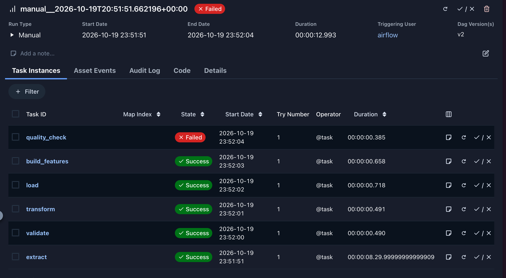
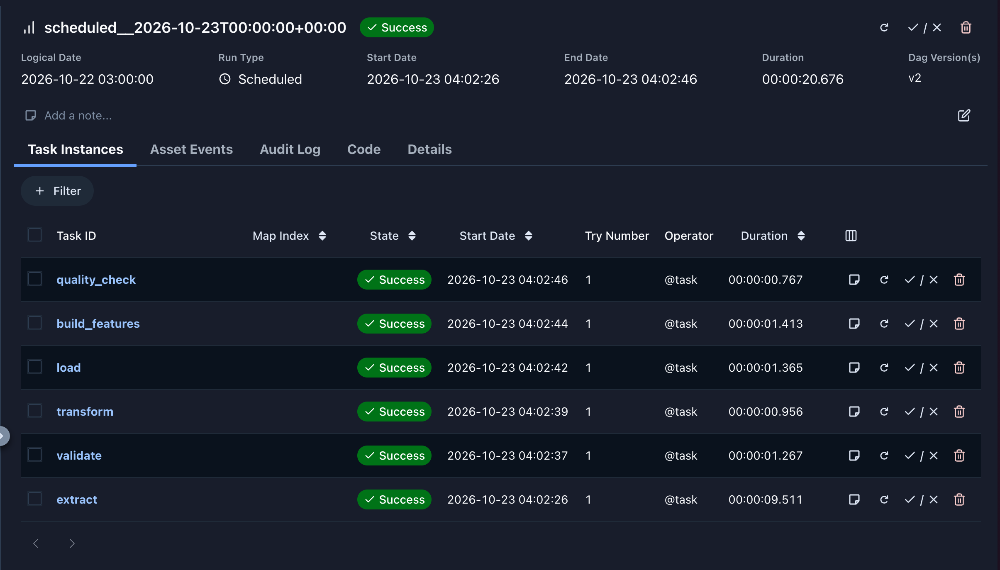

# ukwiki-patrol

Ukrainian Wikipedia receives about 2,700 non-bot article edits per day, and about 1.5% of them are later reverted, mostly as vandalism or test edits.
Volunteer patrollers review recent changes in chronological order, so a harmful edit waits in the same queue as thousands of harmless ones.
ukwiki-patrol scores every new edit with the probability that it will be reverted and serves a ranked patrol queue.
The model is retrained weekly, because editing behaviour and vandal tactics keep changing.
The goal is that most edits that end up reverted appear in the top 10% of the queue within minutes of being saved.

Design document: [docs/design.md](docs/design.md).

## Quick start

Requires Docker, [uv](https://docs.astral.sh/uv/), Python 3.12+, GNU make.

```bash
make setup   # creates .env from .env.example, installs the pinned environment (uv.lock)
make lint    # ruff
make up      # MinIO :9000/:9001, PostgreSQL :5433, MLflow :5001, Airflow :8080
```

| Service | URL | Login |
|---|---|---|
| Airflow | http://localhost:8080 | none (local SimpleAuthManager, all admins) |
| MLflow | http://localhost:5001 | none |
| MinIO console | http://localhost:9001 | `minioadmin` / `minioadmin` (from `.env`) |

## Data

Raw edits come from the Ukrainian Wikipedia recentchanges API, one Parquet partition per UTC day
(`data/raw/date=YYYY-MM-DD/edits.parquet`), user names already replaced by a salted hash. The
feature table is exported next to it (`data/features/...`). Both are versioned with DVC;
the remote is S3-compatible MinIO from `docker-compose.yml` (`s3://dvc`, endpoint
`http://localhost:9000`, configured in `.dvc/config`; credentials come from `.env`).
The data is ~10 MB in total (29 days, 79,159 edits), so it is not sampled.

```bash
make up && make data-pull        # dvc pull from MinIO
uv run dvc status                # "Data and pipelines are up to date."
```

What arrives, by DVC md5 (also in `data/raw.dvc` and `data/features.dvc`):

| Path | Files | md5 |
|---|---|---|
| `data/raw` | 29 | `b0437d6f298a142d3c052d44766faccf.dir` |
| `data/features` | 29 | `f4cbadfd0ac13f6c59cc285096808665.dir` |

After the pipeline has written new partitions, `make data-version` runs `dvc add` + `dvc push`
and stages the updated `.dvc` files for the commit.

The remote is the MinIO container on the machine that ran the pipeline, so `make data-pull` works
where that MinIO volume exists (the defense laptop). The recentchanges API keeps only 30 days, so
a fresh machine cannot re-collect these dates either.

## Pipeline

`dags/ukwiki_daily.py`, one run per UTC day:
`extract → validate → transform → load → build_features → quality_check`.
The logic lives in `src/ukwiki_patrol/pipeline.py`; the DAG only wires it.

**Batch = data interval, never the clock.** The schedule is
`CronDataIntervalTimetable("@daily", timezone="UTC")`, chosen over keying on
`data_interval_start` alone: in Airflow 3 a plain `@daily` makes the start and end of the interval
the same instant. Every task reads the date from `data_interval_start` (a manual run may set it
with the `date` param instead). `start_date` is 2026-09-20, the first full day the API still had;
`catchup=True` with `max_active_runs=1` backfills the days in order.

**Idempotent.** Each step overwrites only its date: Parquet partitions are rewritten, and
`load`/`build_features` run `DELETE ... WHERE date = :d` and the insert in one transaction.
Re-running 2026-10-01 (`docker compose exec airflow airflow tasks clear ukwiki_daily -s 2026-10-01 -e 2026-10-01 -y`):

| | `clean_edits` for 2026-10-01 | `features` for 2026-10-01 | `clean_edits` total |
|---|---|---|---|
| first run | 2950 | 2950 | 79159 |
| second run | 2950 | 2950 | 79159 |

**Quality gate.** `validate` checks the raw schema; `quality_check` fails the run on zero rows, a
feature/clean row-count mismatch, duplicate or null keys, rows outside the interval, a label
rate outside 0.2–10%, or fewer rows than half the 7-day median. Test: a manual run with
`corrupt=true` repeats 20% of the rows, as an upstream pagination bug would:

```bash
docker compose exec airflow airflow dags trigger ukwiki_daily --conf '{"date": "2026-10-18", "corrupt": true}'
# quality_check fails: "quality check failed for 2026-10-18: 721 duplicate revids"
docker compose exec airflow airflow tasks clear ukwiki_daily -s 2026-10-18 -e 2026-10-18 -y   # restores the day
```




## Baseline and model

`make train` trains the rule baseline and LightGBM on a time split of fully matured days
(train 2026-09-20 – 09-29, 7-day gap, test 2026-10-07 – 10-11; design 5.4) and logs both to
MLflow (http://localhost:5001, PostgreSQL backend, artifacts on MinIO). It refuses to run with
uncommitted code or data that differs from `data/features.dvc`, so the two lineage tags,
`data_hash` and `git_commit`, always name what produced the run.

| Test period 2026-10-07 – 10-11 | rule baseline | LightGBM |
|---|---|---|
| PR-AUC (random ≈ 0.010, 132 reverted of 13,810) | 0.063 | **0.120** |
| capture@10% (random = 0.10) | 0.505 | **0.762** |
| recall at precision 0.30 | **0.038** | 0.008 |

LightGBM wins on the ranking metrics the queue uses; neither reaches precision 0.30 at a useful
recall, so the rule wins that row. Both are far below the design target (PR-AUC 0.25), which
needs text features and longer history (design 5.3, deferred).

Registry: `ukwiki-patrol` version 2 (run `7ad16291775f40b8a7fd586fd1f38b25`), tagged
`data_hash=f4cbadfd0ac13f6c59cc285096808665.dir`, `git_commit=b14ec8c03b…`, alias `champion`.
Promotion is a human step: `make promote VERSION=<n>`.

**Reproduce a registered run with one command:**

```bash
make reproduce                 # the champion; or make reproduce RUN_ID=<run id>
```

It checks out `git_commit` in a temporary worktree, `dvc pull`s the data named by `data_hash`,
retrains there and compares PR-AUC with the original within **0.001** (LightGBM is
single-threaded and deterministic). Result: `pr_auc original 0.120010, reproduced 0.120010: OK`.

To load the model from the laptop, `.env` sets `MLFLOW_ENABLE_PROXY_MULTIPART_DOWNLOAD=false`
so artifacts are downloaded through the tracking server.

## Maturity scorecard

| Property | Evidence a reviewer checks | Added in |
|---|---|---|
| Repository reproducible from a clean clone | CI is green; `make setup` and `make lint` succeed on a fresh clone | Lab 1 |
| Design document exists and is current | `docs/design.md` follows the template, every section filled or marked as an assumption | Lab 1 |
| Data versioned | `make data-pull` retrieves `data/raw` and `data/features` with the md5s above | Lab 2 |
| Pipeline idempotent | 2026-10-01 run twice: 2950 / 2950 rows, table above | Lab 2 |
| Quality gate present | the `corrupt=true` run fails `quality_check` (721 duplicate revids), screenshot above | Lab 2 |
| Experiments tracked | every run in MLflow experiment `ukwiki-patrol` has parameters, metrics, `data_hash` and `git_commit` | Lab 2 |
| Model registered with lineage | `ukwiki-patrol` v2, alias `champion`, tagged with data hash and commit; `make reproduce` | Lab 2 |
