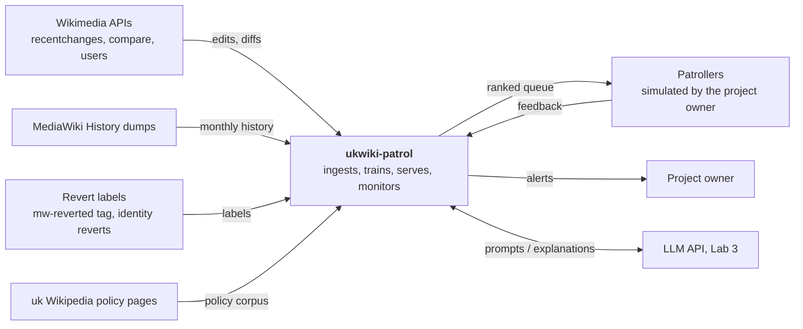
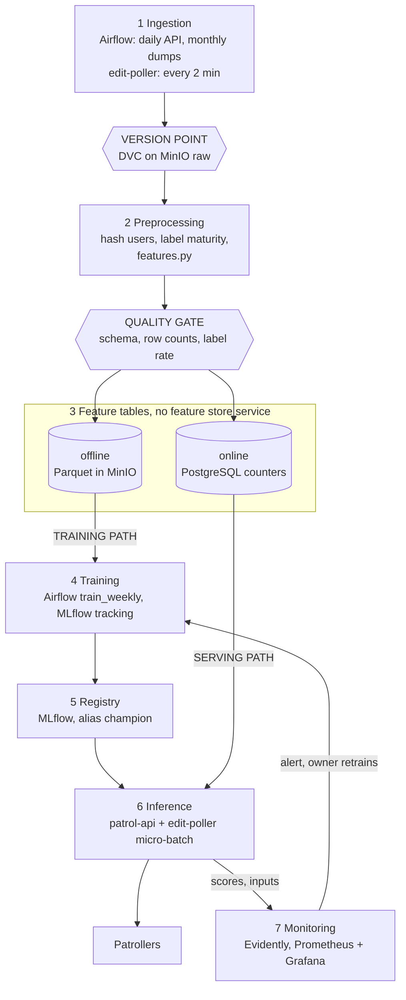
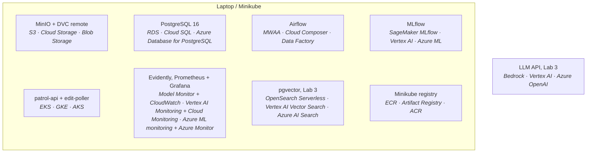

# ukwiki-patrol: revert-risk scoring for Ukrainian Wikipedia patrol

## 1 Overview

Ukrainian Wikipedia receives about 2,700 non-bot article edits per day, and a small share of
them (about 1.5%) are later reverted, mostly as vandalism or test edits. Volunteer patrollers
review recent changes in chronological order, so a harmful edit waits in the same queue as
thousands of harmless ones. ukwiki-patrol scores every new edit with the probability that it
will be reverted and serves a ranked patrol queue. 
The desired outcome is that most edits that end up reverted appear in
the top 10% of the queue, within minutes of being saved.

## 2 Motivation

- **Why it matters.** ~40 edits a day end up reverted, and readers see them until a patroller
  gets there. Patrol attention is the bottleneck: ~98% of a chronological queue is fine edits.
  Ranking reorders the same queue so risky edits are seen first.
- **Why now.** Unregistered editors became temporary accounts (`~2026-…`), breaking "is an IP"
  rules; vandal waves are bursty (2026-09-28: 176 reverts vs a median of ~35); and labelled data
  for the new regime is already available from the API and dumps.
- **Who consumes the predictions.** Patrollers (editors with patrol rights) working through
  recent changes. In this course project the consumer is simulated by the project owner using
  the patrol queue page (Lab 4) and the patrol agent (Lab 5); no change is made on Wikipedia.
- **How often.** Continuously: a new edit is expected every ~30 seconds on average. Observed
  median time-to-revert is under 2 hours on most days, so a score that arrives a day later is
  worthless; the system must score within minutes.
- **Why a system and not a notebook.** The input distribution moves (temporary accounts, vandal
  waves, see above), and labels arrive late and keep arriving for days. A one-off model
  trained on a frozen sample degrades silently; ingestion, relabelling, drift monitoring and
  retraining have to run on a schedule.
- **What happens when predictions are wrong.** A false negative leaves vandalism visible to
  readers for longer: the same cost as today, because patrollers still see the full stream. A
  false positive spends a patroller's minute on a good edit and, if repeated for the same
  newcomer, risks biting a good-faith editor. The system therefore only ranks; it never
  reverts, warns or blocks anyone.

## 3 Success metrics

| Layer | Metric | Target | Type |
|---|---|---|---|
| Business / decision | **Queue capture@10%**: share of eventually reverted edits of a day that rank in the top 10% of that day's scores | ≥ 60% (random order gives 10%). **Assumption**: patrollers review ~10% of the stream (~270 edits/day); to be revised if the consumer states a different capacity | satisficing in Lab 1, optimizing for the product |
| Model | **PR-AUC** on the time-based test period, labels matured for 7 days | ≥ 0.25 and ≥ rule baseline + 0.05. Prevalence is ~0.015, so a random model scores ~0.015. **Assumption** until the Lab 2 baseline is measured | optimizing |
| Model (guard) | Recall at precision 0.30 | ≥ 0.40 (**Assumption**) | satisficing |
| System | **Scoring freshness**: time from edit timestamp to stored score, p95 | ≤ 10 min | satisficing |
| System | `/score` latency p95 (diff fetch included) | ≤ 2 s | satisficing |
| System | Daily ingest partition complete by 03:00 UTC | 100% of days in a month | satisficing |

## 4 Requirements and constraints

### 4.1 Functional requirements

| # | Requirement |
|---|---|
| F1 | **Input:** a Ukrainian Wikipedia revision id from the main namespace (ns 0), made by a non-bot account. |
| F2 | **Callers:** `edit-poller` (every 2 minutes, all new edits); the patrol queue page and the patrol agent (on demand, single edits). |
| F3 | **Output** of `POST /score`: `{revid, score ∈ [0,1], model_version, threshold, top_features[3], scored_at}`. |
| F4 | `GET /queue?limit=50`: unreviewed edits of the last 24 hours ordered by score, with title, diff link and reasons. |
| F5 | `POST /feedback`: a patroller marks an edit `ok` or `vandalism`; stored and used as a label overriding the revert label. |
| F6 | Daily ingestion of yesterday's edits and re-collection of the day 8 days back to refresh labels; monthly load of the history dump. |
| F7 | Weekly training run producing a challenger model in the registry; promotion only after the rule in 5.4 and human approval. |
| F8 | Lab 3: for a queued edit, an explanation citing the relevant Wikipedia policy, retrieved from the policy corpus. |

### 4.2 Non-functional requirements

| Category | Requirement |
|---|---|
| Freshness | Edits scored within 10 min p95 of the edit timestamp. Training data: partitions up to D-1. Labels considered final after a **7-day maturity window** (**Assumption**: covers ≥ 99% of reverts; Lab 2 checks it against the p99 of `revert_delay_h`). |
| Latency and throughput | `/score` p95 ≤ 2 s including the MediaWiki diff fetch, ≤ 200 ms when the caller supplies the diff. Observed load: 2,730 edits/day average, 3,606 maximum (≈ 0.04 edits/s). Designed for 5 requests/s to allow backfills, >100× the average. |
| Availability and fallback | 99% availability of `patrol-api` during demo hours (**Assumption**: no on-call outside them). If the model cannot be loaded, the service serves the rule baseline and reports `model_version = baseline-rules`. If the MediaWiki API is unreachable, the poller backs off exponentially and the freshness alert fires; the queue shows a "stale" banner. |
| Reproducibility | Environment pinned by `uv.lock`; data versioned by DVC per partition; every training run logs git commit, DVC data hash, parameters and seed to MLflow; a registered model is rebuilt by one command (Lab 2). Re-running ingestion for the same interval rewrites the same partitions (idempotent). |
| Adaptability | New data: daily partitions and monthly history snapshots enter through the same ingestion module and the same quality gate. New models: weekly retrain on a rolling 26-week window of matured data (**Assumption**), registered as `challenger`, promoted to `champion` by alias. New label sources (patroller feedback) are merged at preprocessing with higher priority. |
| Observability without ground truth | For the 7 days before labels mature: input drift (share of unregistered editors, `size_delta` distribution, edit volume), score distribution (PSI vs the training reference), share of edits above threshold, and an early lower-bound precision of the top 50 using labels already arrived. Label-based PR-AUC and queue capture are computed weekly on matured days only. |
| Cost and resource ceilings | Local: one laptop, 16 GB RAM (**Assumption**), Minikube limited to 4 GB. Wikimedia APIs: one request at a time, `maxlag=5`, User-Agent with contact. LLM (Lab 3): ≤ 10 USD/month (**Assumption**). Cloud column: estimate in 6.7, not run. |

### 4.3 In scope and out of scope

**In scope:** Ukrainian Wikipedia, main namespace, non-bot edits; revert-risk scoring and
ranking; daily and monthly ingestion; weekly retraining; drift monitoring; a patrol queue page;
policy-grounded explanations (Lab 3); a patrol agent that reads the queue (Lab 5).

**Out of scope:** any write action on Wikipedia (reverting, warning, blocking); other
namespaces and other language editions; deleted or suppressed revisions; real integration with
patroller tools (Special:RecentChanges, gadgets); identifying people behind accounts;
real-time streaming infrastructure (Kafka, Spark), see 7.1.

## 5 Methodology

### 5.1 Problem statement

**Framing: binary classification, used for ranking.** For each edit, predict
`P(reverted within 7 days | information available when the edit is saved)`. The queue sorts by
this probability; the threshold for "flag" is set at the 90th percentile of the last week's
scores, matching the 10% review capacity.

**Rejected framing: unsupervised anomaly detection** on edit features. It needs no labels, but
labels exist in quantity (≈ 1,200 positives per month from the API, many more from history),
and "unusual" is not "harmful": large good-faith edits by experienced editors are unusual too.
Also rejected: regression on time-to-revert, because most edits are never reverted and the
consumer needs an order, not a duration.

### 5.2 Data

**Sources**

| Source | What | Arrival | Used for |
|---|---|---|---|
| recentchanges API (uk.wikipedia.org) | edit metadata, tags incl. `mw-reverted` | live; the API keeps ~30 days | daily ingestion, labels for recent days, serving input |
| compare API | diff between a revision and its parent | per edit, on request | added/removed text at training and serving |
| list=users API | registration date, groups | per user, on request | account age at serving |
| MediaWiki History dumps (dumps.wikimedia.org) | full edit history with precomputed identity-revert labels and causal user counters | monthly snapshot, ~first week of the month; last two snapshots kept upstream | training history 2024-01 onwards |
| Wikipedia policy pages (uk), CC BY-SA 4.0 | text of patrol, vandalism, neutrality, verifiability and copyright policies | refreshed monthly | Lab 3 retrieval corpus |

**Labels and their delay.** Label = edit reverted within 7 days. Two definitions exist:
`mw-reverted` tag (API, includes manual reverts) and identity revert (dumps, sha1 match).
Lab 2 measures their overlap on common dates and keeps the source in a `label_definition`
column. Observed delay: median 0.07 h to 2.5 h per day, one day with 18 h; the tail decides the
maturity window. Labels for the last 7 days are incomplete: 2026-10-17 and 2026-10-18 have the
highest edit counts and the lowest revert counts of the window (20 and 17), which is right-
censoring, not a quiet weekend.

**Checklist justification**

- **A time axis.** Every edit has a second-precision timestamp. Lab 2 ingests "the next day"
  from the API and "the next month" from the dumps; drift can be emulated by replaying history
  week by week, and real drift exists (temporary accounts, vandal waves).
- **Enough history to hold out a period.** History dumps from 2024-01 to 2026-08 (32 months,
  ≈ 2.5 M edits at the observed rate, **Assumption** until loaded) plus the rolling API window.
  Held out: 2026-07-08 to 2026-08-31 as test, see 5.4.
- **Labels with a known arrival delay.** Yes: median about an hour, final after 7 days
  (**Assumption**, measured in Lab 2). Lab 4 monitors inputs and scores during the 7 days and
  label metrics afterwards.
- **A text surface or a documented corpus.** Both: the added and removed text of each edit is
  the data itself, and the Ukrainian Wikipedia policy pages are the retrieval corpus for Lab 3.

### 5.3 Techniques

**Baseline (rule):** score = number of triggered rules, ties broken by recency:
(1) unregistered editor (IP or temporary account); (2) `size_delta < −500` bytes or page
blanking tag; (3) added text with ≥ 50% uppercase letters, a character repeated ≥ 5 times, or a
hit in a profanity lexicon; (4) empty edit summary on a non-minor edit.
This is also the production fallback (4.2).

**Candidate:** LightGBM on tabular and text-statistics features, plus one stacked feature: the
out-of-fold probability of a logistic regression on character 2–5-gram TF-IDF of the added text.
Chosen for training speed on a laptop and for SHAP-based reasons in `top_features`.

**Features and their serving-time source**

| Feature | Training-time source | Serving-time source |
|---|---|---|
| `is_unregistered` (IP or temporary account) | dumps: `event_user_is_anonymous`, `event_user_is_temporary`, `~` prefix | recentchanges row: user name prefix |
| `account_age_days` | dumps: `event_user_registration_timestamp` | list=users at request, cached in the PostgreSQL online table |
| `user_prior_edits` | dumps: `event_user_revision_count` (value at edit time) | PostgreSQL counter updated by `edit-poller`. **Not** the API `editcount`, which differs (see 6.9, skew) |
| `user_revert_rate_90d` | offline aggregate over **matured** labels only, computed as of the edit time | PostgreSQL online table, refreshed daily |
| `page_revert_rate_90d`, `page_edits_24h` | offline aggregates, computed as of the edit time | PostgreSQL online table; `page_edits_24h` updated by poller |
| `size_delta`, `is_new_page`, `is_minor`, `hour_utc`, `weekday` | edit row | recentchanges row / request payload |
| `comment_len`, `comment_is_auto` | edit row | recentchanges row |
| save-time tags (whitelist: `mw-blank`, `mw-replace`, `mobile edit`, `visualeditor`, …); revert tags excluded | edit row | recentchanges row |
| added-text stats (length, uppercase share, max char run, URLs, digits, lexicon hits, Cyrillic share) | compare API, same function as serving | compare API at request |
| `tfidf_lr_score` | out-of-fold prediction | the same LR model, logged in MLflow with LightGBM |

### 5.4 Experimentation and validation

**Split: by time, with a gap equal to the label maturity window.** A random split would put
the same vandal wave (2026-09-28) and the same page on both sides and would let user and page
aggregates computed later leak backwards.

| Part | Period | Note |
|---|---|---|
| train | 2024-01-01 – 2026-04-30 | history dumps |
| gap | 7 days | no example uses a label the model could not have had |
| validation | 2026-05-08 – 2026-06-30 | early stopping, threshold |
| gap | 7 days | |
| test (held out) | 2026-07-08 – 2026-08-31 | touched once per candidate |
| recent check | 2026-09-20 onwards (API) | temporary-account era; reported separately, matured days only |

**Offline metric:** PR-AUC (optimizing); queue capture@10% and recall at precision 0.30
(satisficing), each also on slices: unregistered editors, new pages.

**Comparing a new model with the current one:** both scored on the same latest two matured weeks,
which are excluded from the challenger's training window so neither model has seen them.
Promotion requires PR-AUC + 0.01 with a paired bootstrap 95% interval excluding zero, no slice
worse by more than 0.02, and human approval (5.5).

### 5.5 Human in the loop

- **Drift alert:** the project owner receives it (6.6), opens the Evidently report, and within
  24 hours decides: ignore with a note, investigate the upstream, or trigger retraining.
- **Model promotion:** the challenger's MLflow comparison report is reviewed by the project
  owner, who moves the `champion` alias by hand. No automatic promotion.
- **Override:** a patroller marks an edit `ok` or `vandalism` in the queue (F5). The edit leaves
  the queue, the feedback is stored, and at the next training run it replaces the revert label
  for that edit. The model never acts on Wikipedia; every action stays with a human.

## 6 Implementation

### 6.1 High-level design

**System context**

**Data flow on the seven layers.** The three required marks are the hexagons. Details of
each step are in 5.2–5.4 and 6.6.

**Deployment, first draft.** Every local component with its managed equivalent
(AWS · GCP · Azure). Lab 4 replaces this with the real cluster topology.

### 6.2 Infra

Component names are the ones used in all three diagrams.

| Component | Local (pinned) | AWS | GCP | Azure |
|---|---|---|---|---|
| Object storage, data lake | MinIO-compatible `pgsty/silo:RELEASE.2026-09-16T00-00-00Z` | Amazon S3 | Cloud Storage | Blob Storage |
| Data versioning remote | DVC 3.67.1 + dvc-s3 3.3.0, remote on MinIO | S3 remote | GCS remote | Azure Blob remote |
| Serving database (predictions, feedback, online feature table, MLflow and Airflow metadata) | PostgreSQL 16 | Amazon RDS | Cloud SQL | Azure Database for PostgreSQL |
| Orchestrator | Apache Airflow 3.3.1, LocalExecutor | Amazon MWAA | Cloud Composer | Azure Data Factory |
| Experiment tracking, model registry | MLflow 3.16.1, PostgreSQL backend, MinIO artifacts | SageMaker with MLflow | Vertex AI Experiments and Model Registry | Azure ML with MLflow |
| Model service | `patrol-api` (FastAPI + LightGBM) | Amazon EKS | GKE | AKS |
| Poller | `edit-poller` (Python worker) | Amazon EKS | GKE | AKS |
| Container registry | Minikube built-in registry | Amazon ECR | Artifact Registry | Azure Container Registry |
| Kubernetes cluster | Minikube 1.33.1, Kubernetes 1.30.0, docker driver, 4 GB | Amazon EKS | GKE | AKS |
| Model and data monitoring | Evidently | SageMaker Model Monitor | Vertex AI Model Monitoring | Azure ML model monitoring |
| Metrics store, dashboards | Prometheus, Grafana | Amazon CloudWatch | Cloud Monitoring | Azure Monitor |
| Vector store (Lab 3) | pgvector 0.8.7 (`pgvector/pgvector:pg16`) | OpenSearch Serverless vector search | Vertex AI Vector Search | Azure AI Search |
| LLM inference (Lab 3) | LLM via API | Amazon Bedrock | Vertex AI generative AI | Azure OpenAI |

### 6.3 Performance

- **Load:** 2,730 edits/day on average, 3,606 on the busiest observed day. **Assumption:** the
  busiest hour carries 3× the average hourly rate, ≈ 340 edits/hour ≈ 0.1 edits/s.
- **Budget per edit:** compare API ≈ 300 ms (**Assumption**, measured in Lab 4), online table
  read ≤ 20 ms, feature computation + LightGBM ≤ 30 ms. Fits the 2 s p95 with margin; the
  poller works serially to respect Wikimedia etiquette, which at 0.1 edits/s leaves it idle
  most of the time.
- **Training:** ≈ 2.5 M rows of history; LightGBM and TF-IDF LR on a laptop in ≤ 15 min
  (**Assumption**).
- **Batch versus online: micro-batch scoring every 2 minutes plus a real-time endpoint.** The
  value of a score decays within hours (median time-to-revert ≈ 1 h), so a nightly batch would
  score edits patrollers already handled. Full streaming (EventStreams → Kafka) would cut
  latency from ~2 min to seconds at a rate of 0.04 events/s, which does not justify running
  Kafka. The real-time `/score` exists for the queue page and the agent, which ask about single
  edits.

### 6.4 Security

- **Secrets:** local `.env` (git-ignored) for MinIO, PostgreSQL and the LLM API key; Kubernetes
  Secrets from Lab 4; in the cloud column AWS Secrets Manager / Secret Manager / Key Vault.
  Wikimedia read APIs need no credentials.
- **Who may call the service:** `patrol-api` is a ClusterIP service, reachable only inside the
  cluster and by port-forward for the demo. Callers (`edit-poller`, queue page, agent)
  authenticate with a static bearer token from a Secret. Only the owner can change MLflow
  aliases.
- **Upstream etiquette:** User-Agent with a contact address, `maxlag=5`, one request at a time,
  exponential back-off on 429/503.

### 6.5 Data privacy

- **Personal data:** user names; in the history dumps, IP addresses of unregistered editors
  before temporary accounts. Edit content is public under CC BY-SA 4.0.
- **Handling:** from Lab 2, preprocessing replaces user names and IPs with a salted SHA-256 key
  **before the version point**, so no raw identifier enters DVC, the feature tables or MLflow. The salt is a
  secret. Raw dump files are deleted after parsing. The Lab 1 collectors still store raw names
  in local, git-ignored files; this is known and fixed by the hashing step.
- **Retention:** raw partitions 12 months; predictions and feedback 90 days; LLM prompts and
  traces 30 days. No profiling of individuals: per-user features are aggregates used only to
  rank edits.

### 6.6 Monitoring and alarms

First draft; Lab 4 implements it.

- **Logged per prediction:** revid, edit timestamp, scored_at, score, model_version, feature
  vector hash, threshold, poller cycle id.
- **Metrics:** ingest rows per partition; max edit timestamp per partition; scoring freshness
  lag; `/score` latency and error rate; daily PSI of score and of key features vs the training
  reference; share of edits above threshold; early top-50 precision with labels arrived so far;
  weekly PR-AUC and queue capture@10% on matured days.

| Alert | Fires when | Receiver |
|---|---|---|
| Ingest stale or short | rows in D-1 < 50% of the 7-day median, **or** the partition's max timestamp is not newer than the previous partition's (job re-read the same data) | project owner |
| Quality gate failed | any check in 6.1 fails; the DAG stops before the feature tables | project owner |
| Scoring freshness | lag > 30 min for 15 min | project owner |
| Service health | `/score` p95 > 2 s or error rate > 5% for 10 min; model fell back to `baseline-rules` | project owner |
| Input or score drift | PSI > 0.2 on score or `is_unregistered` / `size_delta` for 2 consecutive days | project owner, then Evidently report |
| Flag share | share above threshold > 2× its 7-day median | project owner |
| Matured performance | weekly PR-AUC drops by > 0.05 vs validation | project owner; triggers `train_weekly` |

Alerts go from Grafana to a Telegram bot and email (**Assumption**: a single owner is the
on-call).

### 6.7 Cost

Estimated monthly cost of the cloud column on AWS, eu-central-1. Only the serving path runs
24/7; training, monitoring and the LLM run on schedule or on demand. **Assumption:** list prices(https://calculator.aws/).

| Service | Sizing assumption | USD / month |
|---|---|---|
| Amazon S3 | 50 GB Standard + requests | ~2 |
| Amazon RDS for PostgreSQL | db.t4g.micro, 20 GB gp3 | ~15 |
| Amazon MWAA | smallest environment, 24/7 | ~360 |
| SageMaker with MLflow | small tracking server, 24/7 | ~450 |
| Amazon EKS | control plane + 2 × t3.medium nodes | ~135 |
| Amazon ECR | < 5 GB images | ~1 |
| SageMaker Model Monitor | one daily ml.m5.large job, 15 min | ~5 |
| Amazon CloudWatch | metrics, logs, alarms | ~15 |
| OpenSearch Serverless (Lab 3) | minimum OCUs | ~350 |
| Amazon Bedrock (Lab 3) | ~300 explanations/day × 3k tokens, small model | ~10 |
| **Total** | | **≈ 1,350** |

About 85% of the cost is three always-on managed control planes (MWAA, SageMaker MLflow,
OpenSearch Serverless), not compute. A cheaper variant runs Airflow and MLflow on the EKS nodes
and pgvector on RDS for ≈ 200 USD/month; that trade-off is kept as an alternative (7.1).

### 6.8 Integration points

- **Upstream: Wikimedia Foundation.** recentchanges / compare / users APIs: JSON as documented
  in the MediaWiki Action API, ~30-day retention, `maxlag` throttling, no SLA. MediaWiki History
  dumps: monthly TSV without header, two snapshots kept, schema can change without notice to
  this project (temporary-account fields were added in 2025–2026). **Contract on this side:**
  the quality gate checks schema and volumes on every load; a failed check stops the pipeline
  instead of producing silent garbage.
- **Downstream: patrollers** via the queue page and the agent. **Contract:** `POST /score` and
  `GET /queue` return the fields in F3–F4; scores are calibrated probabilities; 10-minute p95
  freshness; recommendations only, never actions. `model_version` tells the consumer when the
  fallback is in use.
- **Downstream: LLM API provider** (Lab 3): prompts contain only public edit text and public
  policy text, no user identifiers.

### 6.9 Risks and uncertainties

| Risk | Mitigation |
|---|---|
| Revert ≠ vandalism: edit wars, good-faith mistakes and reverts of experienced editors are positives too | Name the target "revert risk", not "vandalism"; manually check 100 top-scored edits in Lab 2; patroller feedback overrides labels |
| Labels right-censored for 7 days | Maturity window; label metrics only on matured days; re-collect D-8 daily |
| Two label definitions (tag vs identity revert) disagree | Measure overlap on common dates in Lab 2; keep `label_definition`; train on one definition per run |
| Training-serving skew on user features: dumps give the edit count at edit time, the API gives it now | Serve `user_prior_edits` from the PostgreSQL counter, never from API `editcount`; Lab 4 compares served vs recomputed features daily |
| Schema change upstream (IP → temporary accounts) | Merge into `is_unregistered`; schema checks in the quality gate; recent-era check in 5.4 |
| Bursty vandal waves dominate a week of labels (2026-09-28) | Cap examples per user per day in training; alert on flag share |
| Adversarial adaptation by vandals | Weekly retrain; text n-grams instead of a fixed word list only |
| Wikimedia throttles or blocks the collector | Etiquette in 6.4; cache diffs; history from dumps instead of the API |
| Business and model metric diverge (PR-AUC up, capture@10% flat) | Report both; capture@10% is the promotion guard for the queue |
| Laptop resources: Minikube 4 GB plus Airflow and MLflow | Airflow LocalExecutor; run training outside the cluster if memory is short |

## 7 Appendix

### 7.1 Alternatives

| Choice | Option rejected | Pros | Cons | Reason |
|---|---|---|---|---|
| Framing | Unsupervised anomaly detection | No labels needed | Unusual ≠ harmful; no target to evaluate against | Labels exist in quantity |
| Architecture | Streaming: EventStreams → Kafka → Spark | Seconds of latency; real stream for Lab 4 drift | Two more services, harder idempotency, 0.04 events/s does not need it | Micro-batch meets the 10-minute freshness |
| Infra (cost) | Managed MWAA + SageMaker MLflow | No operations work | ≈ 800 USD/month of control planes (6.7) | In a real deployment: Airflow and MLflow on EKS |
| Tool | Feast feature store | Point-in-time joins, one registry of features | One more service; a handful of counters at 0.04 edits/s fit one PostgreSQL table; dumps already carry as-of-edit counters | Shared `features.py` + PostgreSQL table; revisit if features multiply |
| Label | Page deletion only | Catches vandal page creations | Rare, delay of days to weeks | Kept as a second label column `page_deleted` |

### 7.2 Experiment results

Placeholder: filled in Lab 2 (baseline, candidate, data versions, MLflow run links).

### 7.3 Performance benchmarks

Placeholder: filled in Lab 4 (measured latency, freshness, resource use on Minikube).

### 7.4 Milestones

- **Lab 2:** Airflow DAGs ingest the API and history into versioned MinIO partitions behind the
  quality gate; the rule baseline and LightGBM are trained on the time split and tracked in
  MLflow with data version and commit; the first model is registered.
- **Lab 3:** an LLM explains why a queued edit looks risky, citing Ukrainian Wikipedia policy
  retrieved from pgvector, evaluated on a labelled set with retrieval and answer metrics.
- **Lab 4:** `patrol-api` and `edit-poller` run on Minikube with health probes, Prometheus and
  Grafana dashboards, daily Evidently reports, and a drift alert that reaches the owner.
- **Lab 5:** a patrol agent reads the queue, fetches diffs, retrieves policy and drafts
  patrol notes for a human to accept, traced and evaluated on ten tasks.
